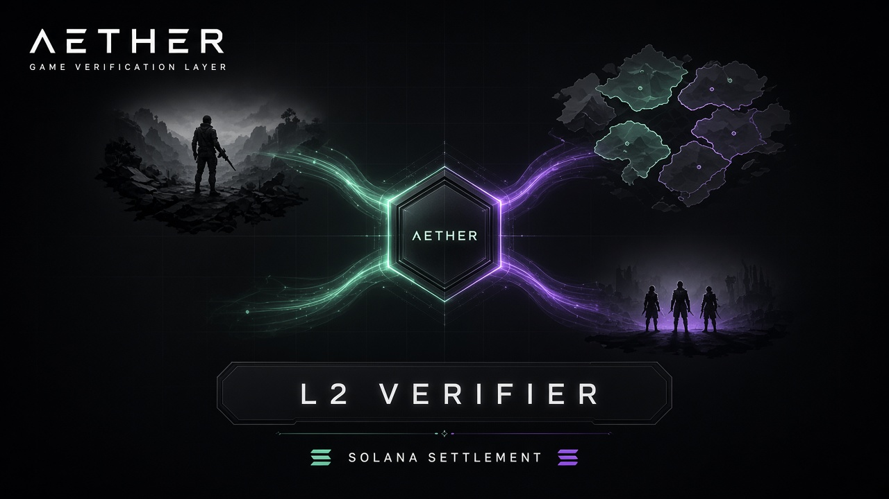

# Aether

<p align="center">
  
</p>

**Verification layer for games.** Titles keep realtime play on their own servers. Aether is the canon for who killed, what dropped, who owns it, and whether that transition was legal.

[Documentation](https://github.com/aethergamify/aethergamify) · [Integrate a game](https://github.com/aethergamify/aether-sidecar) · [On-chain programs](https://github.com/aethergamify/aether-programs) · [L2](https://github.com/aethergamify/aether-l2)

---

Aether is not a game. It is infrastructure that **other games plug into**.

A studio still runs movement, physics, matchmaking and presentation. When something must be true for every player, every market and every dispute — a kill, a drop, a craft, a transfer — the game does not decide. It attests that an action happened. Aether **re-executes** the rules. The game then **reads the result back**.

```
  Game A          Game B          Game C
 (MMO)         (shooter)       (strategy)
    │               │               │
    └───────────────┼───────────────┘
                    ▼
            Aether sidecar
                    ▼
            Aether L2 verifier
            one kernel · many titles
                    ▼
            Solana
```

The product is **rejecting an illegal state transition** — not logging whatever a studio minted.

---

## Repositories

| Repository | Role |
|------------|------|
| **[aethergamify](https://github.com/aethergamify/aethergamify)** | Hub: architecture, verification model, map of everything |
| **[aether-l2](https://github.com/aethergamify/aether-l2)** | Permissioned SVM and economy kernel |
| **[aether-programs](https://github.com/aethergamify/aether-programs)** | Game programs, rulesets, tests, replay |
| **[aether-sidecar](https://github.com/aethergamify/aether-sidecar)** | L3 next to **your** game server |
| **[aether-minecraft](https://github.com/aethergamify/aether-minecraft)** | One example client. Not the product. |

---

## What a connected game gets

| The game still owns | Aether is canon for |
|---------------------|---------------------|
| Movement, camera, physics | Whether an item could exist |
| Session, matchmaking | Caps, craft, transfer policy |
| “This action happened” | Who killed, what dropped, who owns it |

Start here: **[hub documentation](https://github.com/aethergamify/aethergamify)** → [sidecar integration](https://github.com/aethergamify/aether-sidecar/blob/main/docs/integration.md).
